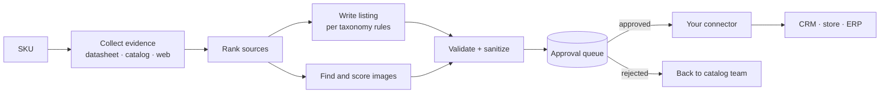

<div align="center">

# Competition Services · E-commerce

**A catalog enrichment engine.**
Give it a SKU. It gathers evidence, writes the listing, scores the images, and hands a reviewer a finished proposal. One click and your own connector ships it to any CRM, store or ERP.


</div>

> **Try it in ten seconds. No accounts, no keys, no database:**
> ```bash
> go run .
> # open http://localhost:8080
> ```
> The built-in demo runs on hand-written sample data and contacts no external service.

---

## At a glance

| | |
|---|---|
| **One binary** | Engine, REST API and embedded web UI ship together. |
| **30 routes** | Enrichment, images, queue, prompts, taxonomy, notifications, health. |
| **44 tests** | Run with the race detector: security, sanitizer, demo, UI, market data, client. |
| **0 reachable vulnerabilities** | `govulncheck` on every change in CI. |
| **Nightly job** | Covers the taxonomies you choose at 02:00 (UTC-6). |
| **Human in the loop** | Nothing reaches the catalog without an approver. |

## What it does

| | |
|---|---|
| **Product copy** | Name, short and long description, specs, tags, SEO title and description. Spanish-first style rules; every prompt is yours to change. |
| **Datasheet reading** | Pulls specifications out of PDF and DOCX files, with limits on size, pages and cost per product. |
| **Source ranking** | Datasheet beats catalog data, which beats web results. The brand is kept only if the original name had it. |
| **Image discovery** | Finds candidates (Brave Search, barcode lookup), scores relevance and transparency, labels quality, prepares and stores the chosen ones. |
| **Taxonomy-aware rules** | One general prompt plus overrides by department, category or subcategory: tone, format, attributes that must always appear. |
| **Warranty text** | Standardizes free-form warranty descriptions into one consistent format. |
| **Nightly enrichment** | Pick the taxonomies to cover; each night new matching products are enriched and queued. |
| **Approval queue** | Pending / approved / rejected, reviewer edits, one pending item per product, who decided what, e-mail and in-app notifications. |
| **Market radar** | A network map of the competitors and channels around a catalog, with a sourced snapshot for Argentina 2026 (Mercado Libre, Temu, Amazon, Frávega…). Every figure carries its source, period and a trust rating. See [docs/MARKET.md](docs/MARKET.md). |
| **Cache and dedupe** | Results are cached for one hour; identical simultaneous requests share a single run. |


## How a product flows



## How it connects


The engine exposes a small REST API. A **connector module** is a thin piece of code you own: it asks for enrichment, waits for approval and copies the result into your system. See **[docs/CONNECTORS.md](docs/CONNECTORS.md)** for the three patterns (pull, poll and sync, batch) with working examples.

```bash
# ask for a proposal
curl -X POST "$ENGINE_URL/products/$PRODUCT_ID/enhance" -H "X-API-Key: $ENGINE_API_KEY"

# read what was approved
curl "$ENGINE_URL/enrichment-queue?status=approved&pageSize=50" -H "X-API-Key: $ENGINE_API_KEY"
```

## Built to keep cost and latency down

- **Result cache** (one hour) and **request merging**: a pre-warm and a click for the same product share one run.
- **Static instructions are cached** on the heaviest steps, so repeat runs skip most of the work.
- **Local first:** text-based PDFs and DOCX files are parsed locally; remote reading is only the fallback for scans.
- **Hard limits** on document size (`PDF_MAX_MB`), documents per product (`PDF_MAX_DOCS_PER_PRODUCT`) and output (`PDF_MAX_TOKENS`), plus a 30-day cache of extracted text so the same datasheet is never processed twice.
- **One outbound client** for text generation: reuses connections, retries only network errors, 429, 5xx and 529 with backoff, honours `Retry-After`, and always keeps the upstream error message.
- **Images are scored locally**, from titles and pixel analysis, with no remote calls.

## Safe by default

- **API key on every private route.** In production the service refuses to start without `API_KEYS`.
- **Outbound fetches are fenced.** Images, PDFs and pages go through a client that checks the real destination IP on every connection and redirect, so it cannot be aimed at your internal network. Downloads and decoded images have size limits.
- **Generated HTML is cleaned.** Output and reviewer edits keep only simple formatting tags, no attributes.
- **Roles decide, not request bodies.** Reviewer identity comes from a trusted header and is checked against the database.
- **Explicit CORS allow-list**, strict CSP on the UI (no CDN, no inline code), size caps on prompts and requests.
- **Nothing ships unreviewed.** Every proposal waits for an approver with a role checked in the database.

Details and the trust model: **[SECURITY.md](SECURITY.md)**.

## Running the real engine

The demo needs nothing. The full engine needs the services below; copy `.env.example` to `.env` and fill it in.

| Needs | For |
|---|---|
| Text-generation credentials (see `.env.example`) | Writing the copy, search terms and warranty text; reading scanned datasheets. |
| `BRAVE_SEARCH_API_KEY` | Web and image search. |
| SQL Server with the `catalog` schema | The product catalog, the queue and the notification tables. See [docs/DATA-MODEL.md](docs/DATA-MODEL.md). |
| Redis (TLS) | Result cache and prompt store. |
| Azure Blob Storage | Storing the chosen images. |
| SendGrid (optional) | E-mail to approvers. |

```bash
for f in migrations/*.sql; do sqlcmd -S "$DB_SERVER" -d "$DB_DATABASE" -U "$DB_USER" -P "$DB_PASSWORD" -i "$f"; done
ENVIRONMENT=production API_KEYS=a-long-random-key go run .
```

Or with Docker:

```bash
docker build -t catalog-enrichment . && docker run --env-file .env -p 8080:8080 catalog-enrichment
```

## API

All routes except `/`, `/health`, `/assets/*` and `/demo/*` need `X-API-Key`. Routes that change configuration or content also check, in the database, that the person named in `X-User-Email` has an approval role.

| Method and path | Purpose |
|---|---|
| `POST /products/:id/enhance` | Generate an enrichment proposal (`?refresh=true` skips the cache). |
| `GET /products/:id/images/search` | Find and score candidate images. |
| `POST /products/:id/images/process` | Prepare the selected images. |
| `POST /warranty/standardize-description` | Standardize a warranty text. |
| `POST /enrichment-enqueue` | Put a proposal in the approval queue. |
| `GET /enrichment-queue` | List items (`status=pending\|approved\|rejected\|all`, `page`, `pageSize`). |
| `GET /enrichment-queue/:id` | One item. |
| `POST /enrichment-queue/:id/approve` · `…/reject` | Decide (approval role required). |
| `PATCH /enrichment-queue/:id` | Edit a pending item (sanitized, approval role). |
| `GET/POST/DELETE /enrichment-taxonomy-config` | Taxonomies covered by the nightly job. |
| `GET /prompts/config` · `PUT/POST/DELETE /prompts/...` | Read and manage prompts (writes need an approval role). |
| `GET /prompts/preview/:id` · `GET /prompts/match` · `GET /taxonomy/options` | Preview the prompt a product would use. |
| `GET /media-resources` · `GET /image-types/mappings` · `POST /image-types/configure` | Map image types to media resources. |
| `GET /notifications` · `PATCH /notifications/:id/read` | In-app notifications. |
| `GET /proxy-image?url=` | Fetch an external image for the UI (SSRF-safe, 5 MB limit). |
| `GET /health` · `GET /cache/stats` | Health and cache statistics. |

A proposal looks like this:

```json
{
  "productId": "…",
  "originalData": { "name": "TALADRO VOLTIX 18V", "shortDescription": "taladro inalambrico con bateria", "tags": ["taladro"] },
  "enhancedData": { "name": "Taladro Percutor Inalámbrico Voltix 18 V …", "shortDescription": "<ul><li>…</li></ul>",
                    "fullDescription": "<p>…</p>", "tags": ["…"], "tituloSEO": "…", "descripcionSEO": "…" },
  "confidence": 0.94,
  "ruleApplied": { "…": "…" }
}
```

## Project layout

```
main.go                 router, product lookup, enrichment pipeline
search_terms*.go        search-term generation and fallbacks
image_search.go         image discovery, relevance scoring
image_analysis.go       transparency and quality analysis
image_processor.go      image preparation for the client
pdf_reader.go, utils.go datasheet reading (PDF, DOCX)
prompts.go              general and per-taxonomy prompts
queue.go                approval queue
taxonomy_config.go      taxonomies for the nightly job
cron.go                 nightly job
notifications.go        e-mail and in-app notifications
market.go               competition network and sourced market snapshot
security.go, safehttp.go, sanitize.go   authentication, SSRF-safe client, HTML sanitizer
demo.go, ui.go, web/    demo API and the embedded web UI
migrations/             SQL for the queue, taxonomy config and schema
docs/                   architecture, connectors, data model, market radar
```

## Documentation

| | |
|---|---|
| [docs/ARCHITECTURE.md](docs/ARCHITECTURE.md) | Components and request flow |
| [docs/CONNECTORS.md](docs/CONNECTORS.md) | Pull, poll-and-sync and batch connector patterns |
| [docs/DATA-MODEL.md](docs/DATA-MODEL.md) | Catalog schema the engine reads |
| [docs/MARKET.md](docs/MARKET.md) | Market radar: sources, periods, trust ratings |
| [SECURITY.md](SECURITY.md) | Trust model and reporting |
| [CHANGELOG.md](CHANGELOG.md) | Release notes |

## Roadmap

- A storage adapter so the engine can read any catalog, not only the current SQL Server schema (see [docs/DATA-MODEL.md](docs/DATA-MODEL.md)).
- More connector examples.
- More market snapshots beyond Argentina 2026.

## Status

Early. The engine is production-shaped, but its data layer is written against a specific SQL Server catalog schema. Copy rules are Spanish-first. There is no license file yet: until one is added, all rights are reserved.

```bash
go test -race ./...    # unit tests for security, sanitizer, demo, UI, market data and the outbound client
```

---

*Sample data in the demo is fictional.*
